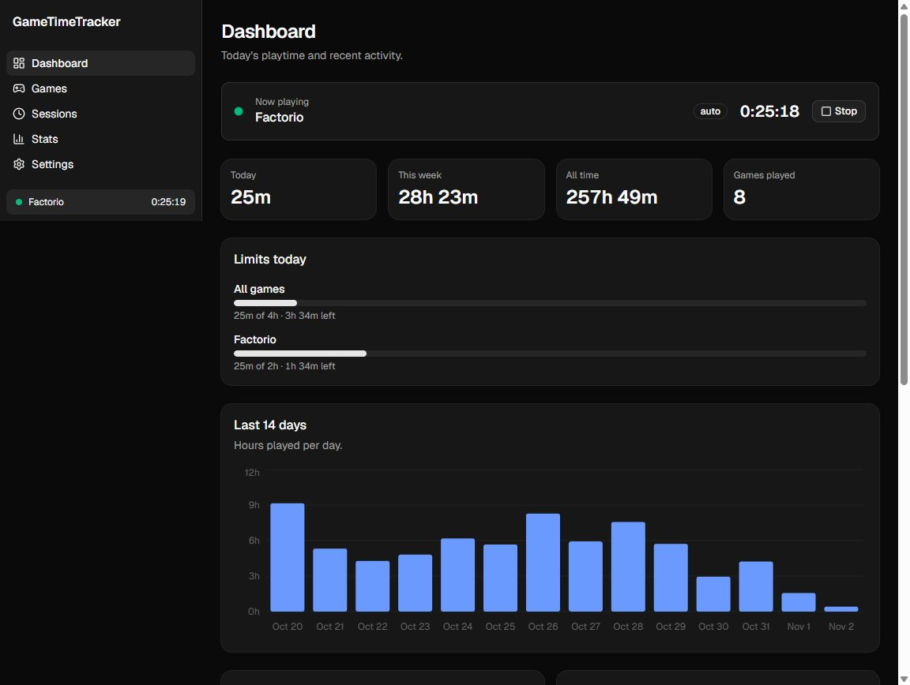
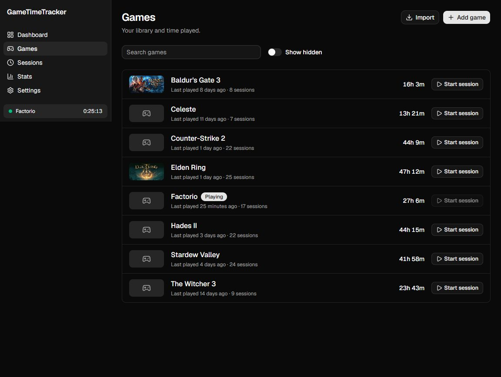
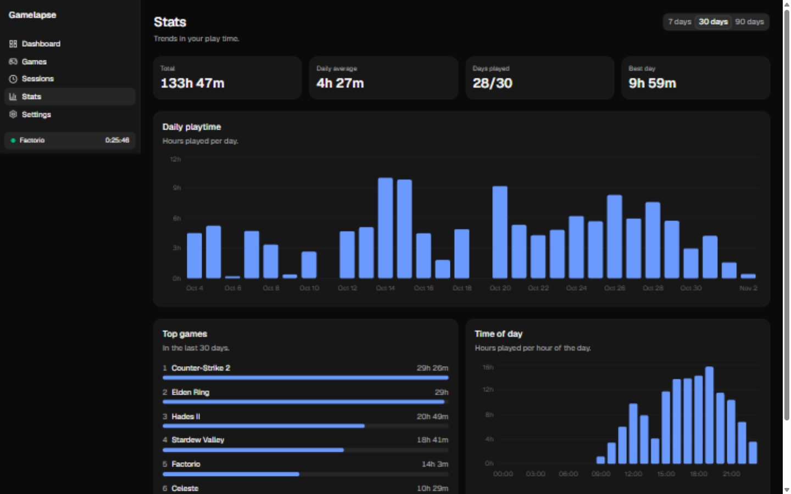

# Gamelapse

Gamelapse is an open source game time tracker for Windows 10 and 11. It lives in the system tray, notices when your games are running, and records how long you play. A dashboard shows your library, sessions and statistics. Everything is stored on your own machine.



## Features

- Automatic detection of running games
- Manual timer for anything the tracker can't see
- AFK detection: keyboard, mouse, controller and lock screen
- Per-game and total time, with daily and weekly stats
- Session history, with editing
- Charts: daily, weekly trend, top games and time of day
- Daily limits and play reminders, with Windows notifications
- Library import from Steam, Epic Games and GOG Galaxy, with cover art
- Heroic Games Launcher import: Epic, GOG and Amazon games installed through Heroic, with playtime and covers
- Games folders: add folders such as `D:\Games`, click Scan, review the suggested names and executables, and tick what to add. Nothing is scanned or added on its own.
- Name and cover lookup through Steam's store search, per candidate and from a "Find cover" button
- Optional Steam Web API import of past playtime
- Tags, merging of duplicate games and custom covers
- CSV and JSON export
- Backup and restore
- Start with Windows
- Auto-update

Epic Games and GOG Galaxy import are tested with fixture files, not live installs. If import misses games on your PC, please [open an issue](https://github.com/furkanyolal/gamelapse/issues). See [CONTRIBUTING.md](CONTRIBUTING.md) for which files to attach.

## Install

1. Download the `.exe` installer from [GitHub Releases](https://github.com/furkanyolal/gamelapse/releases).
2. Run it.

Requires Windows 10 or 11, x64. The installer is per-user and needs no admin rights.

The installer is not code signed yet, so Windows SmartScreen may show "Windows protected your PC". Click **More info**, then **Run anyway**. The project plans to sign builds through [SignPath Foundation](https://signpath.org/), which signs open source projects for free.

## How it works

A background tracker in the Rust backend polls running processes every 5 seconds. It matches them against the games in your library by executable path or install folder. When a game matches, a session starts. While it runs, the tracker writes a heartbeat on every poll. If Gamelapse or your PC crashes, the open session is closed at its last heartbeat the next time the app starts.

If there is no keyboard, mouse or controller input for 10 minutes, the clock pauses. The idle time is not counted, and play resumes on the next input. A locked screen counts as idle. The threshold is configurable in Settings.

Everything is stored locally in SQLite under `%APPDATA%\com.furkanyolal.gamelapse`. There is no telemetry. The only network calls are:

- cover art downloads (optional)
- the Steam Web API (optional)
- the per-candidate Steam store search you trigger
- update checks against GitHub

## Adding games

- **Automatic import:** Gamelapse scans your installed launchers on startup. You can turn this off in Settings ("Import on startup").
- **Import button:** on the Games page, or **Scan** per launcher in Settings.
- **Add game:** pick an executable by hand.

### Games folders

For games from other sources, add folders such as `D:\Games` in Settings, under **Games folders**. Gamelapse never scans or watches them on its own. A scan runs only when you click **Scan**, and nothing enters your library until you review the suggested names and executables and confirm. Emulator folders scan as one entry per folder for now.

Some games use anti-cheat that hides the process path from other programs. If a game is never detected, add it by its install folder instead of its exe.

## Steam Web API

Steam stores your playtime from before you installed Gamelapse. To import it:

1. Get an API key at <https://steamcommunity.com/dev/apikey>.
2. Find your SteamID64.
3. Make the game details of your Steam profile public.
4. In Settings, open **Steam Web API**, enter both values, click **Save**, then **Fetch playtime**.

The key is stored locally, in plain text, in the app's `settings.json`. It is only sent to Steam.

## More screenshots

<details>
<summary>Games and stats</summary>





</details>

## Building from source

Prerequisites:

- Rust stable (MSVC toolchain)
- Node.js 24
- Visual Studio Build Tools with the "Desktop development with C++" workload
- WebView2 (already part of Windows 11)

```sh
npm install
npm run tauri dev     # run with hot reload
npm run tauri build   # build the installer
```

## Contributing

See [CONTRIBUTING.md](CONTRIBUTING.md).

## License

[MIT](LICENSE)

## Acknowledgements

Built with [Tauri](https://tauri.app), [shadcn/ui](https://ui.shadcn.com) and [Recharts](https://recharts.org). Inspired by [Playnite](https://playnite.link) and [ActivityWatch](https://activitywatch.net).
